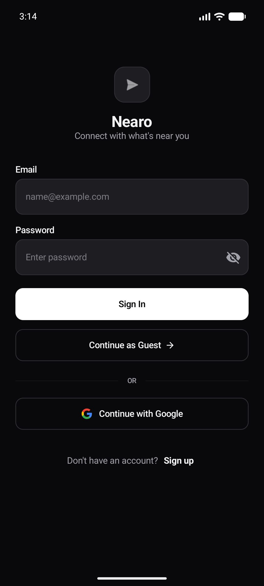
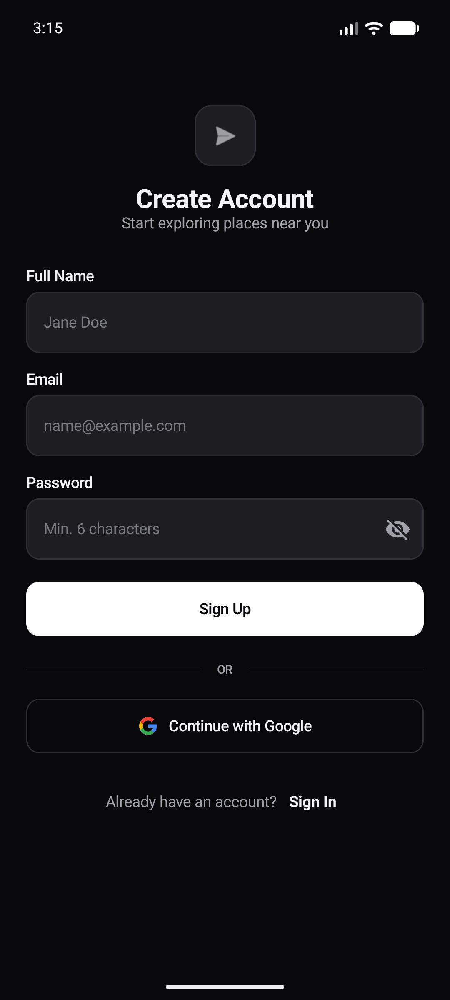
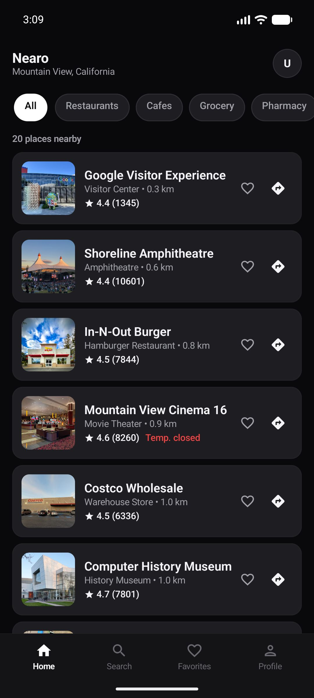
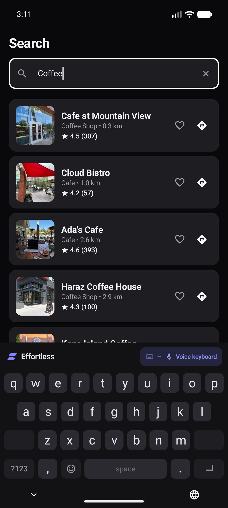
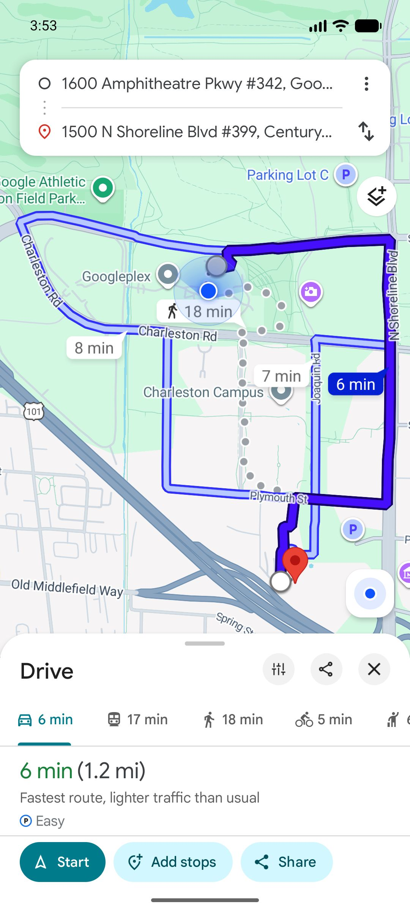
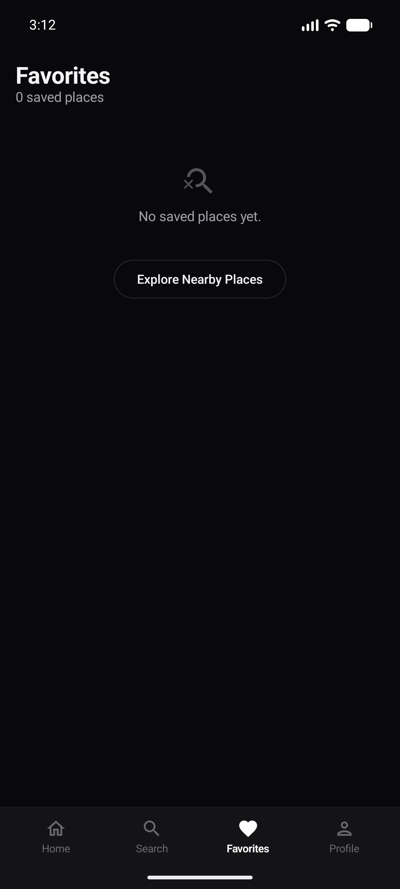
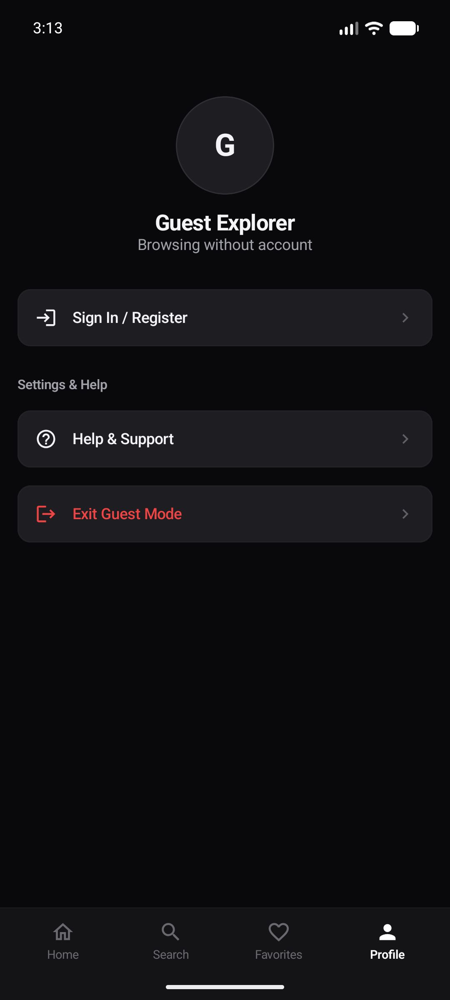

# Nearo — Nearby Store Finder 📍

A modern, high-performance Android application built with **Jetpack Compose** and **Material 3** that helps users discover nearby stores, restaurants, cafes, supermarkets, pharmacies, and points of interest with real-time location awareness and intelligent caching.

---

## 📸 App Preview & Screenshots

<p align="center">
  
  
  
</p>

<p align="center">
  
  
  
</p>

<p align="center">
  
  
  
</p>

### Screen Breakdown
| Screen | Highlights |
| :--- | :--- |
| **01. Login** | Clean minimal authentication with Email, Password, Google Sign-In, and instant Guest Mode. |
| **02. Sign Up** | Secure account creation with inline validation. |
| **03. Home Feed** | Location-aware store feed displaying distance, rating, review counts, and operational status. |
| **04. Categorized View** | Quick category chips (Restaurants, Cafes, Grocery, Pharmacy) with server & local distance sorting. |
| **05. Instant Search** | Debounced (350ms) text search biased around current GPS coordinates. |
| **06. Place Details** | Rich store metadata: directions intent, phone dialer, opening hours, and clean website cards (`• Opens in browser`). |
| **07. Open in Map** | Turn-by-turn navigation directly in Google Maps with driving ETA, route previews, and place ID targeting. |
| **08. Offline Favorites** | Room-backed offline persistence for quick access to saved places. |
| **09. Profile & Settings** | Account status, theme preferences, and guest session management. |

---

## ✨ Key Features

- **🎯 Nearest-First Store Discovery**: Displays stores in strict ascending distance order from the user's location, combining Google Places API `RankPreference.DISTANCE` with local Haversine calculations.
- **⚡ Zero Redundant API Calls**: Comprehensive caching layer with in-memory TTL caching, mutex request deduplication, and GPS micro-jitter suppression (< 150m movement threshold).
- **🎨 Minimal Monochrome Design**: Sleek, distraction-free Material 3 UI designed with clean contrast, native typography, and subtle micro-interactions.
- **🌐 Clean Website URL Cards**: Normalizes deep locator URLs into clean root domains (e.g. `https://www.costco.com/`) with standard `[ ↗ ]` external browser launch indicators.
- **💾 Offline Persistence**: Store your favorite places locally with Room Database so they remain available without internet connectivity.
- **🧭 One-Tap Navigation**: Direct navigation integration launching Google Maps with verified coordinates and destination place IDs.

---

## 🛠️ Tech Stack & Architecture

### 🧑‍💻 Core & UI
* **Kotlin** – 100% pure Kotlin codebase.
* **Jetpack Compose** – Declarative UI toolkit.
* **Material 3** – Curated typography, surfaces, and theme tokens.
* **Compose Navigation** – Type-safe screen routing and back-stack handling.
* **Coil** – Asynchronous image loading with cached place photo loading.

### 🧩 Architecture & Design Pattern
* **Clean Architecture** – Clear separation into `domain`, `data`, and `presentation` layers.
* **MVVM Pattern** – Unidirectional Data Flow (UDF) using Kotlin `StateFlow` and immutable UI states.
* **Koin** – Dependency injection for repositories, viewmodels, and location clients.

### 🌍 Location & Places
* **Google Places SDK (New)** – Real-time nearby search, text search, place details, and photo loading.
* **Google Play Services Location** – Battery-efficient fused location provider with GPS jitter filtering.
* **Pure Kotlin Haversine Calculator** – Framework-independent distance calculation (`DistanceCalculator`).

### 🗄️ Local Persistence & Network
* **Room Database** – Local database for offline favorites with type converters.
* **Firebase Authentication** – Cloud identity management and guest authentication.

---

## 🧪 Testing

The project includes unit tests for business logic, caching, distance calculations, and URL formatting:

```bash
# Run all unit tests
./gradlew test
```

### Test Coverage Highlights:
- **`GooglePlacesStoreRepositoryCacheTest`** – Verifies memory cache hits, TTL expiry, force refresh bypass, and GPS jitter tolerance.
- **`HomeViewModelTest`** – Verifies lifecycle loading, error retention, pull-to-refresh, and nearest-first sorting.
- **`DistanceCalculatorTest`** – Validates Haversine formula against known coordinate pairs.
- **`UrlFormatterTest`** – Validates URL cleaning, host extraction, query parameter removal, and scheme normalization.
- **`LocationRepositoryImplTest`** – Verifies location state flows and GPS jitter filtering.

---

## 📄 License

This project is licensed under the Apache License 2.0.
